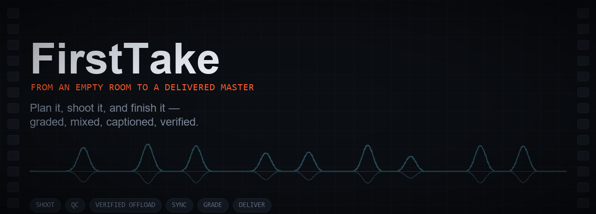
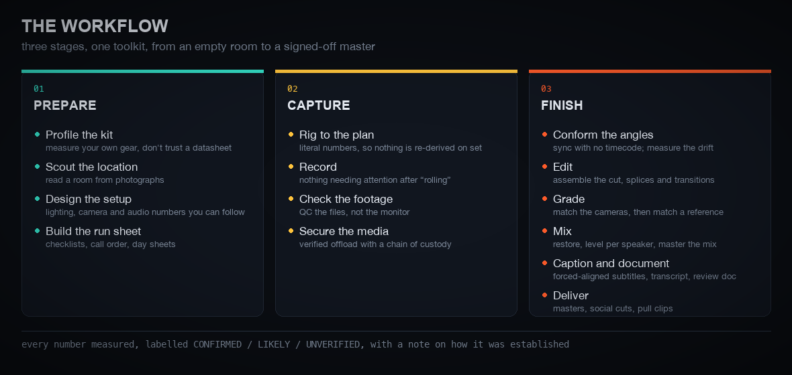
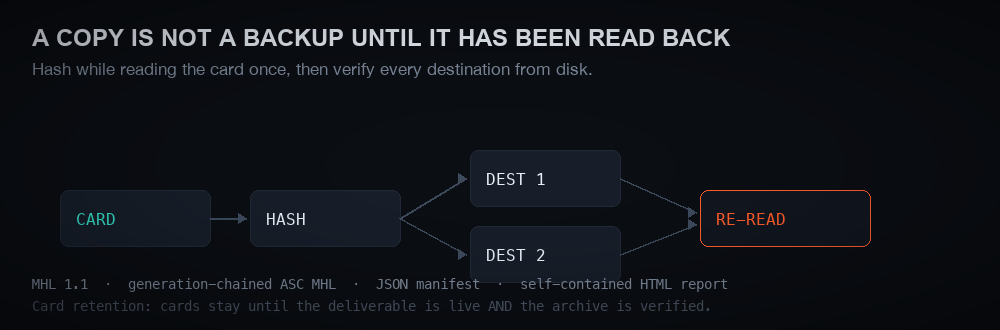
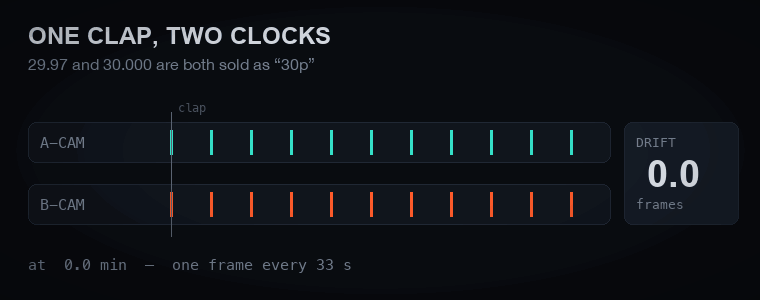
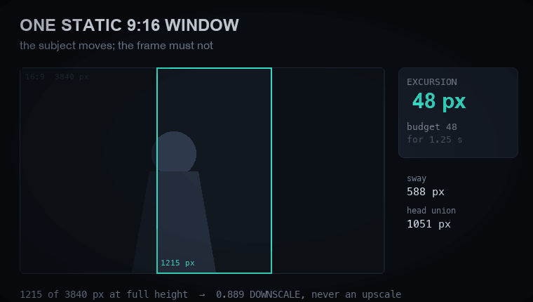
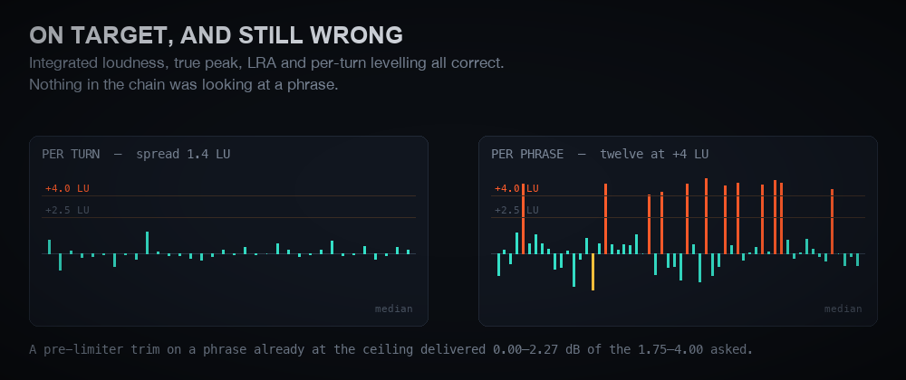
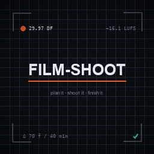

<div align="center">

# FirstTake

<sub>by <a href="https://sklarstad.com">Sklarstad</a> · free and open source (Apache 2.0)</sub>



**From a pile of cards to a finished, verified edit — assembled by script.**

Cameras that share no clock. Forty minutes with someone who will not sit down twice. Nobody on set
whose only job is to watch the levels. FirstTake takes what came back and does the slow part of
post for you: synced, transcribed, cut, matched, mixed, captioned and built as a real timeline in
your editor — with every number in it measured, and every step checked before it says it is done.

<sub>
<code>python 3.12+</code> · <code>ffmpeg</code> · <code>numpy</code> &nbsp;•&nbsp;
every tool here runs standalone — no assistant, no API key
</sub>

</div>

---

## Get started

In Claude Code:

```
/plugin marketplace add emersonsklar/firsttake
/plugin install firsttake@firsttake
```

Then say **"Set up FirstTake for me."** It checks your computer, installs ffmpeg and the Python
packages after asking you about each one, and finishes with a practice run on sample footage.
Other ways to install, including without the plugin system, are under [Install](#install).

---

## What it does for your edit

Hand it the cards. You get back:

- **Every camera and recorder on one timeline**, with no shared timecode — synced from the audio,
  with the **drift** a clap cannot see measured and corrected.
- **A transcript with every word attributed to its speaker**, and a review document in programme
  time, so notes point at the right frame.
- **The cut, assembled from the plan** — reframes, fades, speed ramps — and **built as a native
  timeline in your editor**, then read back out of it and compared to the plan, clip by clip.
- **Two cameras matched by measurement** — one corrector each, fitted from the footage rather than
  dialled in by eye.
- **A mix mastered to target**, levelled per speaker and checked per phrase, which is where a mix
  that meters correctly still goes wrong.
- **Captions timed by a forced aligner**, not by guesswork, and kept in step with every new render.
- **The deliverables**: the master, vertical social cuts with burned-in captions, and pull clips,
  each measured against the plan before it is called finished.

It works on footage you already have. Nothing in post depends on having planned the shoot with it —
planning just means fewer surprises to measure later.

### In the editor you already use — or none

The cut is described once, as a plan, and FirstTake builds it in whichever editor you have:

| Editor | Status | What you get |
|---|---|---|
| **DaVinci Resolve** | ✅ recommended | Driven from a Python script; can script the grade too. Has delivered every programme here. |
| **Premiere Pro** | ⚠️ early access | Driven through a panel inside the app. Colour and retime must be baked into the media first. |
| **CapCut** | ⚠️ early access | Free. Writes CapCut's own draft file, since CapCut has no scripting API. Proven on CapCut 9.6 at 30 fps; it refuses 29.97 and ProRes 4444 titles (both measured), and the export is a manual step that FirstTake then measures. |
| **No editor at all** | ✅ | `assemble_ffmpeg.py` renders a full-quality master, not a proxy. You give up the editable timeline, not the quality. |

If an editor cannot reproduce something in the plan exactly, the build **stops and names it**.
It never quietly approximates. Details further down, in [Act 3](#act-3--finish).

---

## What you can say to it

You work with FirstTake the way you'd brief an assistant editor: in plain words, with timecodes as
rough pointers. These are real requests from real projects (names replaced):

**Before the shoot**
- *"Here's my kit: two cameras, these lenses, a two-channel wireless lav, and these drives. Set up my kit profile."*
- *"Here's a photo of the room. Where should I put the cameras, the lights and the interview chairs?"*
- *"Generate a run sheet for the shoot day: call times, setup order and the checklist."*

**On the day**
- *"Here's the card from camera A. Offload it to both drives and verify every copy."*
- *"Check this test footage before we roll: exposure, focus and audio levels."*

**Cutting words and fillers**
- *"When we start the actual questions at around 00:36:04, I say 'uh so [guest], uh uh [partner] has been'. Cut out the 'uh so… uh uh' and start with me saying [partner]."*
- *"Cut the 'but that's of course' so the line reads 'continue to engage with the tools, experiment yourself'."*
- *"Cut the first 00:00:00:20. She's mid-sentence and takes a deep breath, so it's weird right at the start."*
- *"[Partner] asked to cut the question starting around 07:38 through her answer ending around 08:14."*

**Fixing jumps and seams**
- *"The cut from 00:01:43 to 00:01:44 is still abrupt. That next section should start at 'how do you think', and we need some clever smoothing there."*
- *"It caught a little of the next clip and you can see her face jump. Cut back to the wide shot after she says 'users'."*

**Audio**
- *"At 00:00:36:04 the word sounds quite loud compared with what came before. Would lowering it a tad help, or is there something else?"*
- *"[Guest] recorded a new voiceover of that line (the file's in Downloads). Put it in instead of her original audio, and make it sound consistent with the rest."*
- *"I'm looking at it in Resolve and the audio is all crackly."*

**Structure, B-roll, titles and graphics**
- *"Open with the teaser (use your recommended #1), then the title card and jingle with no speech behind it, then the interview."*
- *"For the intro, go through my B-roll, find shots we haven't used yet, and assemble them so they feel conceptually right and cinematic."*
- *"Change the title to '[Guest] on [Topic]', regenerate the title card and let me preview it. I want to check the spacing and alignment."*
- *"I got the official logo in Downloads. Use it in the shorts and the main video, at the same relative size as last episode."*

**Framing and look**
- *"Check the framing of both the wide and the tight shot. Since we post at 1080, would zooming, trimming or rotating help the documentary feel?"*
- *"Make the grade whatever's standard for professional work."*
- *"Use the product shot over that line instead of her, then have her name card appear in the next shot."*

**Social shorts**
- *"[Reviewer] liked #1 and #4. For #4, change the title to 'Advice for Builders'. For #1, extend her section to around 12:36."*
- *"Bring the edits from short 4 over to the main video. Work out your own cover for the cut, since we don't want the vertical crop."*

**Captions, transcripts and delivery**
- *"Generate an SRT for the latest review copy, and always keep the video and subtitles in sync."*
- *"The burned-in subtitle after the cold open is missing the word 'I'."*
- *"Render a ProRes 422 HQ of roughly 00:14:04:21 to 00:14:38:20. Tell me how big it'll be first."*
- *"Render the newest version to something under 35 MB."*

**When the editor gets in the way**
- *"I imported the timeline but the mastered audio isn't in there."*
- *"The video is 16 seconds long but the timecode in Resolve only goes to 13:03."*
- *"Resolve crashed, I just reopened it."*

**Keeping it tidy**
- *"Clean up the folder structure."*
- *"Would any of this be helpful to submit back to FirstTake to add into the plugin?"*

---



The same method runs the whole way, from an empty room to a delivered master. Acts 1 and 2 are
optional: they exist because the cheapest fault to fix in post is the one that never got recorded.

## Act 1 — Prepare

**Profile the kit, scout the location, design the setup, build the run sheet.** The output is a
plan made of literal numbers — *"lantern centre 75, 46 inches out, 30° down, 100%"* — because a
principle has to be re-derived on set and a number does not. Lighting, camera and audio placement,
then the checklists, call order and day sheets that fall out of the same profile. Rooms can be
scouted from photographs before anyone travels.

The reason it starts with profiling: **this is not a gear database.** Every hardware number belongs
to a specific body, card, mic or drive, and almost none survive a kit change. A confident unmeasured
number is worse than no number, because the whole workflow depends on trusting it in a room where
you cannot check it.

📖 `references/onboarding.md` · `references/location-scout.md` · `references/templates/`

---

## Act 2 — Capture

**Rig to the plan, record, check the footage, secure the media.** The plan from Act 1 arrives as
literal numbers so nothing has to be re-derived on set, and the checklists are ordered so the
things that cannot be fixed later happen first.

The reason it is built that way: **nothing may require attention after "rolling."** If you are also
the person on camera you cannot catch a focus hunt or a clipped level, and you cannot fix one
without stopping someone mid-answer. Stakes are asymmetric — forty minutes with a busy executive is
not a reshoot you get to request — so redundancy is weighted heavily and cleverness at zero.

**Checking the footage means checking the files**, not the monitor: log-aware exposure, focus
stability, frame timing and dropped frames, 8-bit hiding in a 10-bit container, per-channel audio.
Cross-camera frame-rate mismatch is the headline check, because it is the one that ruins an edit
silently.

### Securing the media — a copy is not a backup until it has been read back



`offload.py` reads the card **once**, hashes as it reads, then **re-reads every destination from
disk** and compares. MHL 1.1, optional generation-chained ASC MHL, a JSON manifest, and a
self-contained HTML report you can hand to anyone.

The retention rule is deliberately strict, because the failure it guards against is silent and
final: **cards stay until the deliverable is live *and* the archive is verified.** Not until the
copy finished. Not until someone said thanks.

📖 `references/qc-interpretation.md` · `references/offload-protocol.md`

---

## Act 3 — Finish

**The largest part of FirstTake, and the reason most people need it.** Six stages take a pile of
cards that share no clock to a signed-off master:

| Stage | What happens |
|---|---|
| **Conform** | Place every recording on one timeline with no shared timecode, measure the drift a clap cannot see, and attribute speech per word from a split-mode receiver. |
| **Edit** | Assemble the cut — splice language, fade *shape* as a first-class parameter, speed ramps with the motion model matched to the motion — then build the multicam timeline natively in the NLE through its scripting API and read it back to verify it. |
| **Grade** | Match the bodies with **one corrector each**, then grade to a reference episode without importing that episode's room. |
| **Mix** | Per-speaker restoration and static levelling, cross-talk ducking driven by the word labels, mastered to target — then checked **per phrase**, which is where it actually goes wrong. |
| **Caption and document** | Subtitles with text from the recogniser and **time from a forced aligner**, plus the reviewer's transcript and review document in programme time. |
| **Deliver** | Masters, vertical social cuts with burned-in captions, PR pull clips — one encode per deliverable, and the sidecars kept in step with the picture. |

Reproducing someone else's graphics template runs through the whole of it: measure the reference
rather than guess it — **size from ink height, family from width, weight from stroke thickness.**

### Any editor, and a cut that can change hands

<div align="center">
<sub><b>DaVinci Resolve</b> &nbsp;·&nbsp; <b>Premiere Pro</b> <i>(early access)</i> &nbsp;·&nbsp; <b>CapCut</b> <i>(early access)</i> &nbsp;·&nbsp; <b>ffmpeg</b> &nbsp;·&nbsp; one plan, four backends</sub>
</div>

The timeline is described once, in an application-neutral plan, and a backend turns it into one
application's calls. That is what lets the person who shot it and the person who finishes it use
different software — and what lets a cut be handed over as *the plan* rather than as a project file
somebody else has to rebuild by hand.

The part that makes it trustworthy is a **capability gate**: where an application cannot reproduce
something exactly, the build **stops and names it**. It never approximates. The expensive failure
here was never "unsupported" — it is a build that reports success having quietly dropped the ease on
a fade or flattened an animated push-in to its first value. Both of those look like a finished
timeline.

✅ **If you have a choice, use Resolve.** It is driven by a Python module from a shell, it has
driven every delivered programme here, and it can script the grade. ⚠️ **Premiere support is early
access**: it is driven by a panel inside the app, and two things are simply absent — colour and
retime. It works, and it will show you its edges.

⚠️ **CapCut support is early access.** CapCut has no scripting API at all, so FirstTake writes CapCut's
own draft file and CapCut opens it like one of its own. It has been proven on **one version
(CapCut 9.6) on one machine**: a probe whose every frame encodes its own frame number was built,
saved by CapCut, read back, exported, and measured — placement, reframes, fades, disabled clips
and PNG titles all landed exactly. Two things were measured going wrong and are refused by name:
**29.97 fps** (CapCut silently re-times it to 30 and moves every cut) and **ProRes 4444 titles**
(drawn about 19% too dark). Export from CapCut by hand, then `capcut_draft.py --check-export`
measures the file. After a CapCut update, `--make-probe` re-runs the proof.

💸 **And you do not have to buy anything.** `assemble_ffmpeg.py` is a third backend that needs no
application at all — as does everything else here: offload and verification, QC, sync, transcription,
subtitles, loudness mastering, LUT fitting, speed ramps, graphic conforming, day sheets. It produces
a **full-quality master, not a proxy**: a shipped 2228-frame short rebuilt from its own plan sits at
**1.08 codes of 255** against the delivered master across every frame. What you give up is the
editable timeline afterwards, not the quality. One condition, and it is measured rather than cautious: the grade must
be baked into the media **once**, never re-applied during assembly. Two implementations of one
colour transform agreed on geometry to r ≥ 0.9989 and were still 14–18% out in the grade, which is
how eight approved review renders turned out not to show what the NLE produced.

⚠️ **Resolve free** probably cannot be driven from a shell — the API covers both editions, but the
preference that lets an outside script connect is documented as Studio-only. That is unverified;
`scripts/resolve_connect.py --check` settles it on a machine that has the free version. Either way
the ffmpeg route is there.

Each application is better at something, and the differences are not small. Resolve can script
colour; **Premiere cannot script colour at all** — neither an ASC CDL nor a LUT — so a graded
handover has to arrive with the grade already in the media. Premiere can keyframe any parameter and
write an exact 29.97; in Resolve the first needs a composition and the second needs a committed
preset. The gate knows every one of those, and `nle_ir.py --compare` tells you what the far end will
refuse *before* you offer it a handover.

📖 `references/post-production.md` · `references/nle-backends.md` · `references/resolve-api.md` ·
`references/premiere-uxp.md` · `references/grade-match.md`

---

### Exhibit A — the clap that doesn't save you



Clap at the top of the take. You should still do it — it is free and survives everything. But a clap
gives you **one point in time**, and the expensive failure is not offset, it is **drift**. Mixed
rates on their own are not the problem: if every file is labelled with the rate it really carries,
Resolve and Premiere play each at its own rate and repeat or drop a frame to fit the timeline. Drift
comes from what the NLE cannot see:

- **A clip fitted to the timeline frame for frame.** Interpret Footage, a changed clip frame rate, or
  a container that says 30.000 when the camera shot 29.97. Now it slides about a frame every
  33 seconds, and over forty minutes two angles end up roughly **70 frames** apart.
- **Clocks that are never exactly nominal.** Two "29.97" bodies, or a camera and a separate
  recorder, disagree by tens of ppm. Every file claims the nominal rate, so there is nothing for the
  NLE to correct. It is small — a frame or two over a long take — and visible on a lav against a wide.
- **Variable frame rate** from phones and some action cams, which slips unevenly.

A single sync point fixes none of these. Add a third body and it is three pairs of clocks, not one.

`sync_cameras.py` probes in up to ten places, so **the spread between probes is the drift
measurement**:

| reading | means |
|---|---|
| spread under ~50 ms across a long span | one constant offset; a single sync point holds |
| spread growing with probe position | genuine drift — check both cameras' frame rates |
| drift near ±1000 ppm | almost certainly 29.97 conformed or labelled as 30.000 |
| no lock | the recordings share no audible content, or one is silent |

It correlates **onset envelopes**, not waveforms — so it works between completely different
microphones, because two mics in one room disagree about spectrum and agree about *when things
start*.

---

### Exhibit B — a vertical cut is a budget, not a crop



A seated subject's head swayed **588 px**; the union of head positions spanned **1051 px** of a
**1215 px** window. No static window holds that with margin everywhere.

The answer is not to abandon a centred frame. Set an **excursion budget** in pixels *and* seconds,
then take the crop nearest the compositional ideal that stays inside it — here 48 px for up to
1.25 s, while the subject leans forward and looks *down*, so no gaze room is wanted at that
instant. And 1215 of 3840 px at full height is a **0.889 downscale**, so sharpness never enters the
argument.

⚠️ Probe density has to scale with the span. A fixed probe *count* reused on a longer clip missed
the subject's furthest lean entirely — the sparse answer would have clipped a head by ~68 px.

---

### Exhibit C — on target, and still wrong



Integrated loudness, true peak, LRA and per-turn levelling all correct — turn-to-turn spread
**1.4 LU** — and one phrase still sat **+2.7 LU** over its speaker's median word. Twelve phrases sat
at **+4 LU or more**, every one of them the same speaker, lifting on question intonation. Nothing in
the chain was looking at a phrase.

And the trap underneath: **a pre-limiter trim on a phrase already pinned at the ceiling barely
changes its loudness.** Thirteen trims of 1.75–4.00 dB delivered **0.00–2.27 dB**, because trimming
ahead of a limiter mostly stops the limiter reducing. Keep it for the crest it buys, then apply the
measured remainder *after* the limiter, where gain is exact.

---

## The through-line

**The failures are quiet.** A sync 40 ms out looks fine on a laptop and wrong on a big screen. A
timeline at the wrong playback rate shows a contented green number while dropping a fifth of the
audio. A guard can report success and do nothing. A check can be written so it cannot fail.

So every claim carries `CONFIRMED` / `LIKELY` / `UNVERIFIED` and a note on how it was established,
and the references read like a post-mortem in places — because those are the expensive ones:

> a still that ignored its own length and silently moved the clip after it · numbered PNGs that
> imported as one image sequence, so 11 of 12 captions never existed · a loudness meter measured in
> the wrong channel layout, 3 dB out · a cached asset keyed on a filename instead of its content ·
> a derived cache of absolute frame numbers that rendered 33 frames long while the build reported
> no problems

---

## Tutorials

The references are written to be read when you need them. These are written to be read in order.

| | |
|---|---|
| [Getting started](docs/tutorials/01-getting-started.md) | The mental model: what is durable, what belongs to one shoot, and why a confident unmeasured number is worse than none |
| [Prep to a run sheet](docs/tutorials/02-prep-to-run-sheet.md) | Profiling the kit, scouting a room from photographs, and turning both into literal numbers |
| [On the day](docs/tutorials/03-on-the-day.md) | Rigging to the plan, and what must be settled before "rolling" |
| [QC and verified offload](docs/tutorials/04-qc-and-verified-offload.md) | Reading `shootcheck` without over- or under-reacting, then making a copy that is actually a backup |
| [Post, end to end](docs/tutorials/05-post-end-to-end.md) | The eleven stages, in the order they actually run |
| [Timeline by script](docs/tutorials/06-timeline-by-script.md) | One plan, either NLE, and a gate that refuses to approximate |
| [**Quiet failures**](docs/tutorials/07-quiet-failures.md) | A field guide to twenty real faults that reported success. Start here if you are debugging |
| [Working conversationally](docs/tutorials/08-working-conversationally.md) | How an operator drives this by chat — timecodes as search hints, and never handing back verification chores |
| [Social cuts](docs/tutorials/09-social-cuts.md) | Deriving vertical shorts from inside an approved programme |

---

## Install

**The easy way:** open this folder in Claude Code and say *"set this up for me"*. Any of the ways
it runs will do — the **terminal CLI**, the **desktop app**'s Code tab, **claude.ai/code** in a
browser, or the **VS Code / JetBrains** extensions. The desktop app and the web app need no terminal
at all. It then follows [`SETUP-FOR-CLAUDE.md`](SETUP-FOR-CLAUDE.md): checks the computer, installs
what's missing once you've agreed to each item, and finishes with a practice run on test footage (a couple of minutes).

**As a Claude Code plugin:**

```
/plugin marketplace add emersonsklar/firsttake
/plugin install firsttake@firsttake
```

Then say *"set up FirstTake for me"* so it can check your computer and install ffmpeg and the
Python packages.

**By hand:**

```bash
git clone https://github.com/emersonsklar/firsttake ~/.claude/skills/firsttake
cd ~/.claude/skills/firsttake
python3 -m pip install --user -r requirements.txt     # Windows: py -3.12 -m pip ...
python3 scripts/doctor.py          # what's ready, what isn't, and how to fix it
python3 scripts/first_run.py       # practice run on test footage, a few seconds
```

Claude Code picks it up from `~/.claude/skills/`. For a single project instead, clone to
`<project>/.claude/skills/firsttake`.

### Does it have to be Claude?

**The tools: no.** Every script under `scripts/` is plain Python plus ffmpeg — argparse, `--help`,
`--selftest`, no model, no API key, no network. Offload and verify cards, QC footage, sync cameras,
master audio, fit LUTs, assemble a cut with ffmpeg: all of it runs from a shell with no assistant
involved at all.

**The automatic part: yes, that much is Claude Code's convention** — and only in two narrow places.
`SKILL.md`'s frontmatter is the format Claude Code reads to decide when a skill is relevant, and
`~/.claude/skills/` is where it looks. Nothing else depends on it.

Everything in between — `references/`, the tutorials, `SETUP-FOR-CLAUDE.md` — is ordinary Markdown
written to be read by an assistant. Point a different coding agent at this folder and it can read the
method and run the same scripts; what it will not do is load itself at the right moment.

Requirements: **Python 3.12+**, a full `ffmpeg` with `ffprobe`, and `numpy`, `soundfile` and
`Pillow` (`requirements.txt`). Optional: `xxhash` (faster hashing), `ascmhl`
(generation-chained manifests), `pymupdf` (PDF page verification).

Works on macOS and Windows. On Windows, `scripts/doctor.py --fix` also turns on Python's UTF-8
mode, which the tools' output needs when an assistant runs them.

**No NLE is required, and nothing here is paid.** DaVinci Resolve Studio, Premiere Pro or the free
CapCut (early access) gives you an editable timeline at the end; without any of them, the same plan
assembles with ffmpeg to a full-quality master. See `references/nle-backends.md`, "Finishing with no NLE at all".

---

## The tools

Useful on their own. Plain Python and ffmpeg — `--help` and `--selftest` on every one, no model and no network. See [Does it have to be Claude?](#does-it-have-to-be-claude).

| | |
|---|---|
| **`shootcheck.py`** | Technical QC for footage and audio. Measured numbers with PASS/WARN/FAIL against explicit thresholds and a stated fix for each. |
| **`offload.py`** | Verified card offload to any number of destinations, with MHL/ASC MHL, JSON manifest and an HTML report. |
| **`sync_cameras.py`** | Places recordings on a reference timeline with no shared timecode, and measures drift. |
| **`diarize_by_channel.py`** | Per-word speaker attribution from a split-mode receiver. |
| **`nle_ir.py`** | One timeline plan, four backends, and a gate that refuses to approximate. |
| **`capcut_draft.py`** | ⚠️ early access — build the plan as a CapCut draft, read back what CapCut kept, and measure its export. |
| **`nle_handover.py`** | Pack a cut for whoever finishes it, and let them prove it arrived whole. |

Plus `build_subtitles.py`, `speed_ramp.py`, `make_proxies.py`, `measure_white_balance.py`,
`conform_graphic.py`, `make_log_view_lut.py`, `fit_clip_trims.py`, `build_day_sheets.py` and a
fixture-based self-test suite.

---

## What it runs, installs and connects to

Everything runs on your own computer. The tools make **no network requests**, send **no
telemetry**, and never upload footage or anything about your shoot.

- **Runs:** the Python scripts in `scripts/`, and `ffmpeg`/`ffprobe` on files you point it at.
- **Installs, only after you agree to each item** (`scripts/doctor.py --fix`): the Python
  packages in `requirements.txt` (numpy, soundfile, Pillow) from PyPI with `pip install --user`;
  ffmpeg through winget (`Gyan.FFmpeg`) on Windows or Homebrew on macOS; and Python 3.12 the same
  way if it's missing. On Windows it can also set `PYTHONUTF8=1` in your user environment.
- **Connects to, only on this computer:** DaVinci Resolve Studio through Resolve's own scripting
  module; Premiere Pro through a panel you install, exchanging job files in
  `~/.firsttake/premiere-jobs`; CapCut by writing a draft folder CapCut opens.
- **Writes:** offload copies, manifests and reports to the folders you choose; the practice run
  to `Documents/firsttake-first-run`; `doctor.py --install-skill` copies this folder to
  `~/.claude/skills/firsttake`, keeping any previous copy as a backup.
- **Optional, your choice:** if you install `mlx-whisper` yourself, `diarize_by_channel.py
  --transcribe` uses it, and that library downloads its speech model from Hugging Face on first
  use.
- **Bundles:** two short synthetic sample videos (`scripts/first_run_footage/`) for the practice
  run. No real person or client footage; see that folder's README for how they were made.

## Free, open source, and yours to improve

FirstTake is **free** under the [Apache License 2.0](LICENSE): use it for personal or client work,
change it, ship it inside your own tools. If you redistribute it or something built from it, keep
the [NOTICE](NOTICE) and the copyright lines, mark what you changed, and credit **FirstTake by
Sklarstad LLC**.

**Contributions are very welcome** — especially quiet failures from real shoots, gear it doesn't
handle yet, and fixes. See [CONTRIBUTING.md](CONTRIBUTING.md).

**If it saved a shoot,** you can [chip in whatever you like](https://sklar.gumroad.com/l/support-firsttake).
It's entirely optional and keeps the work going. Questions: [support@sklarstad.com](mailto:support@sklarstad.com)

---

## What it is not

**Not a crew replacement.** It is built for the case where you are the operator *and* the person on
camera, or the only person in the room, and the shoot is not something you can ask to do again.

**Not a style guide.** Where it reproduces a look, it does so by measuring a reference and stating
the numbers, not by applying a rule from a book.

<div align="center">



<sub>Every image here is generated by the asset script in docs/ — plots of the measurements
themselves. No stock art, no screenshots, no footage. The thumbnail set is <b>drawn at each
size rather than downscaled</b>: 21px mono type does not survive a 32× reduction, so below 256 the readouts come
off, below 96 the wordmark does, and at 32 only the record light remains.</sub>
</div>
